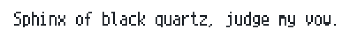

<h1 align="center">fonts</h1>

<p align="center">The fonts I use, packaged as a Nix flake with a preview of each.</p>

Each folder in `fonts/` is one family and one Nix package. Most are upstream fonts or remixes; Astra Pixel and Nib are original. "Sonic" variants add a contextual-alternates (`calt`) feature for faster reading.

## Install

```bash
nix profile install github:y0usaf/fonts              # every family
nix profile install github:y0usaf/fonts#commit-mono  # one family
nix flake show github:y0usaf/fonts                   # list families
```

## Astra Pixel

An original monospaced pixel font for dense code: a 5 × 10px cell at 10px, with printable ASCII and light box drawing. The package also holds three alternates: Facet, Loom and Reed.

[Download the TTF](fonts/astra-pixel/AstraPixel-Regular.ttf) ·
[Offline comparison](assets/previews/astra-pixel/comparison.html) ·
[Sources and design notes](sources/astra-pixel/README.md)



<!-- previews:start -->
<h2 align="center">⚡ Sonic Fonts ⚡</h2>

#### Atkinson Hyperlegible Mono Regular Sonic


#### CommitMono 200 Italic Sonic


#### CommitMono 200 Regular Sonic


#### Go Mono Regular Sonic


#### Iosevka Term Slab Regular Sonic


#### Iosevka Term Slab Condensed Sonic Italic


#### Iosevka Term Slab Condensed Sonic


#### RuneScape Regular Sonic


#### Terminus Regular Sonic


<h2 align="center">🍉 Regular Fonts 🍉</h2>

#### my 3x5 tiny mono pixel font Regular


#### CommitMono 275 Italic


#### CommitMono 275 Regular


#### Cozette Vector Px Regular


#### Departure Mono Regular


#### Departure Mono Condensed Regular


#### Departure Mono Semi Condensed


#### Departure Mono Ultra Condensed Compact


#### Envy Code B 10pt


#### Envy Code B 10pt Condensed


#### Envy Code B 10pt Semi Condensed


#### Iosevka Pixel Slab Regular


#### Iosevka Pixel Slab Compact Regular


#### Iosevka Pixel Slab Condensed Compact Regular


#### Iosevka Pixel Slab Squat Regular


#### Iosevka Term Slab Condensed Bold


#### Iosevka Term Slab Condensed Bold Italic


#### Iosevka Term Slab Condensed Italic


#### Iosevka Term Slab Condensed Light


#### Iosevka Term Slab Condensed Light Italic


#### Iosevka Term Slab Condensed


#### m3x6 Mono Regular


#### m5x7 Mono Regular


#### m5x7 Mono Condensed Regular


#### Monocraft Black Italic


#### Monocraft Black


#### Monocraft Bold Italic


#### Monocraft Bold


#### Monocraft ExtraLight Italic


#### Monocraft ExtraLight


#### Monocraft Italic


#### Monocraft Light Italic


#### Monocraft Light


#### Monocraft SemiBold Italic


#### Monocraft SemiBold


#### Monocraft


#### Moono Regular


#### Nib Regular


#### Quaver Mono Regular


#### Quaver Mono Condensed Regular


#### RuneScape


#### RuneScape Small


#### RuneScape Small Mono


Preview phrase: “Sphinx of black quartz, judge my vow.”

Regenerate the SVGs and this README section with Nix:

```bash
nix develop -c ./scripts/generate_previews.py
```

Or without Nix:

```bash
python3 -m venv .venv
. .venv/bin/activate
python3 -m pip install fonttools uharfbuzz
./scripts/generate_previews.py
```
<!-- previews:end -->

## Credits

- **Nib**: original, 5 × 7 glyphs in a 6 × 11 cell, built from shared stroke rules.
- **m5x7 Mono** (6 × 9) and **m5x7 Mono Condensed** (5 × 9): remixes of [m5x7](https://managore.itch.io/m5x7) by Daniel Linssen, CC0.
- **m3x6 Mono** (4 × 8): remix of [m3x6](https://managore.itch.io/m3x6) by Daniel Linssen, CC0.
- **Quaver Mono** (6 × 8) and **Quaver Mono Condensed** (5 × 8): remixes of [Quaver](https://caffinate.itch.io/quaver) by Nathan Scott, CC0.
- **Another Tiny Pixel Font Mono 3x5** by [alasseearfalas](https://alasseearfalas.itch.io/another-tiny-pixel-font-mono-3x5), CC0, unchanged.

The remixes keep the original bitmaps and only narrow glyphs that don't fit the cell. Each family folder's `LICENSE` carries its credit.

## License

AGPL-3.0-or-later; see [`LICENSE`](LICENSE). Bundled fonts keep their upstream licenses.
